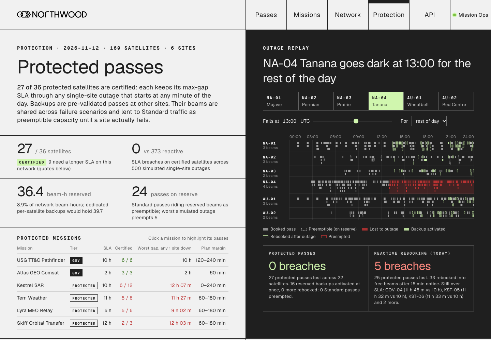

# Protected passes: single-site-failure guarantees for a shared ground network

**Live demo:** https://mohith26.github.io/northwood-protected-passes/

An unofficial concept feature for [Northwood Space](https://www.northwoodspace.io)'s network software, built by Mohith Gajjela (Duke CS). It is not affiliated with Northwood. Every site, satellite and operator is synthetic.



## What it is

A **Protection** page for the network console. It turns "we'll find you another antenna if a site goes down" into a guarantee you can write into an SLA:

* **Certify** each protected satellite: it keeps its maximum time between contacts (max-gap SLA) through **any single-site outage, starting at any minute of the day**, with a 15-minute notice lead.
* **Pre-validate backups**: for every failure scenario, the backup passes at other sites are chosen and checked against beam capacity ahead of time.
* **Share the reserve**: only one site fails at a time, so the beams held for "NA-04 fails" and "AU-01 fails" can be the same beams. The reserve at each site and minute is the *max* over failure scenarios, not the sum (the shared-risk idea from shared backup path protection in optical networks).
* **Lend the reserve**: Standard traffic is booked onto reserved beams as preemptible passes. They only lose the beam if the matching site actually fails.
* **Quote honestly**: satellites that cannot be certified on this network get the max-gap SLA they *can* be certified at, and the site failure that binds.
* **Replay any outage**: pick a site, a start time and a duration; see lost passes, activated backups, preemptions, and the same outage handled by reactive rebooking.

Why Northwood: its own launch posts say operators "overbuild to hedge against downtime, and idle backup capacity still depreciates", and that the network should deliver "contacts reliable enough for commercial operators to write SLAs around." Its API already lets operators search, reserve, update and cancel passes; this is a tier on top of that.

## Results on the synthetic network (all computed in the page from `data/network.json`)

160 satellites (36 in Protected tiers), 6 sites (4 in North America, 2 in Australia, 2 to 4 beams each), 24-hour plan with a 12-hour look-ahead. 500 random single-site outages (any site, any start, 30 minutes to a full day), same draws for every policy:

| Policy | SLA breaches on the 27 certified satellites | Booked beam-h | Reserve beam-h | Standard passes preempted |
|---|---:|---:|---:|---:|
| Plan at the SLA, reactive rebooking (today's pattern) | 373 | 50.2 | 0 | 0 |
| Protection-aware plan, reactive rebooking | 3 | 65.2 | 0 | 0 |
| Protection-aware plan + dedicated backups per satellite | 0 | 65.2 | 39.7 | 439 |
| Protection-aware plan + **shared reserve** (this feature) | **0** | 65.2 | **36.4** | 523 |

What this says, plainly:
* Most of the gain comes from **planning**, not the reserve. Farthest-reach scheduling (the minimum-contact plan) books each pass as late as the SLA allows, so a failure right after a contact leaves nothing to recover with. Planning certified satellites with the smallest extra margin that keeps them survivable removes 370 of 373 breaches. It costs 15 more booked beam-hours.
* The reserve closes the last gap and is what makes the zero a **check**, not a hope. Reactive rebooking on the same plan still breaches 3 times.
* Sharing the reserve across failure scenarios saves 3.4 beam-hours (8%) versus per-satellite backups at this load. That gain is modest here because utilisation is low; it grows when backups of different satellites for different failures collide at the same site and minute.
* 9 of 36 protected satellites cannot be certified at their contracted SLA with six sites. The page quotes the SLA each can be certified at (for example KST-02: 12 h 15 m, bound by the Alaska site).

## How it works (`core/protect.js`)

1. **Orbits and passes.** Keplerian elements with J2 secular drift (RAAN, argument of perigee, mean anomaly), ECI to ECEF via GMST, WGS84 sites, elevation mask 10 degrees. Rise and set times are bracketed on a 30 s grid and refined by bisection. Long windows (MEO, GEO) are split into bookable slots.
2. **Primary plan.** For each satellite, the minimum number of contacts that keeps every gap within the SLA, subject to per-site beam capacity: the farthest-reach greedy cover (optimal without capacity; a unit test checks it against brute force).
3. **Failure scenarios.** Site *k* fails at *s0* (15-minute grid) and stays down for the rest of the horizon. A contact in progress is cut at *s0*. Backups must start at least lead + grid step after *s0*, so a real outage at any minute maps to a scenario that loses a superset of its contacts and only uses backups it can still activate.
4. **Protection-aware planning.** For each protected satellite, tighten the planning target by the smallest margin in {0, 60, 120, 180, 240} minutes that makes it survivable under every scenario (checked without capacity first).
5. **Shared reservation.** For every scenario, protected satellites that would breach pick backups (farthest-reach again, preferring beams already reserved) under `booked + scenario load <= beams`. Reserve = max over scenarios. Dedicated mode instead sums each satellite's union of backups.
6. **Standard traffic** is booked into what is left; any pass that overlaps reserved beams is marked preemptible.
7. **Outage replay.** Lost passes are removed, the matching scenario's backups activate (preempting Standard passes where needed), and any remaining gap is rebooked reactively after the notice lead. The baseline skips step 5 and only rebooks.

## Run it

```bash
python3 -m http.server   # then open http://localhost:8000
node --test tests/protect.test.mjs
node data/generate.mjs   # regenerates data/network.json from the seed (tests check it is identical)
```

No build step. The page loads Geist from Google Fonts (a free stand-in for Northwood's Px Grotesk) and nothing else.

## Tests (11, `node --test`)

Generator reproduces the committed data; circular orbits keep their radius and GEO stays on station; a sun-synchronous orbit precesses about 0.9856 deg/day under J2; pass edges sit on the 10-degree mask; gap metric edge cases; farthest-reach cover equals the brute-force minimum on 60 random instances; firm load plus reserve never exceeds any site's beams; shared reserve never exceeds dedicated; **certified satellites have zero breaches over 600 random outages while reactive rebooking has many**; activated backups never sit at the failed site and start after failure plus lead; Monte Carlo is seed-deterministic.

## Honest limitations

* Synthetic network. Site locations, beam counts, fleets, SLAs and the 15-minute notice lead are assumptions, not Northwood data. Northwood's real sites and scheduler are not public.
* One antenna type (Portal-style multi-beam TT&C). No Prism dish slew time, band or spectrum-licence constraints, weather, or link budgets.
* Single-site failures only. Two simultaneous site failures, partial beam loss on one array, and correlated failures (a shared fibre path) are not covered.
* The SLA is max-gap only; data-volume SLAs for payload downlink are not modelled.
* Greedy planning, not an exact optimiser. The reserve is not minimal, and the 8% sharing gain is specific to this load.
* Tighter protected plans take capacity: one Standard satellite (HAL-35) misses its nominal SLA in the protected plan.
* The guarantee is checked on a 15-minute scenario grid plus a lead-time buffer, and verified empirically with random outages; it is not a formal proof for every edge case (for example, contacts in the look-ahead window after the planning day).

## Novelty note

Searched Northwood's site and blog (technology, Prism and Series C posts) and public competitor material (AWS Ground Station, KSAT, ATLAS Freedom and Flex Scheduler, Quindar's missed-pass rebooking, Leaf Space, RBC Signals). Reactive rebooking after a missed pass exists (Quindar with ATLAS), and capacity-guarantee tiers exist (RBC Signals, ATLAS "Guaranteed Availability"). I did not find a ground-network product that pre-validates backups per failure scenario, shares that reserve across scenarios, lends it out as preemptible capacity, and certifies a max-gap SLA per satellite under any single-site outage. If Northwood already does this internally, this is a second implementation to compare against.

---
Unofficial concept demo by Mohith Gajjela. Not affiliated with Northwood Space. Synthetic data.
